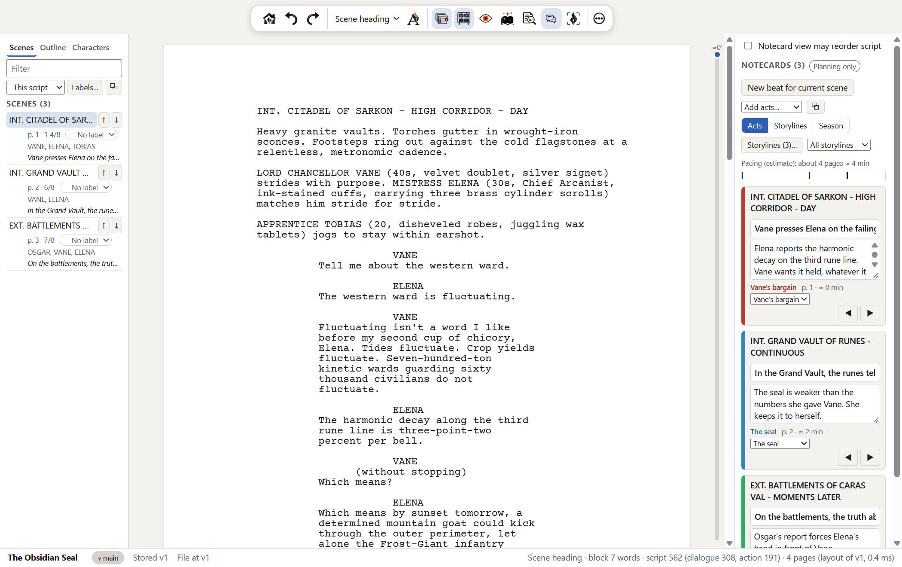
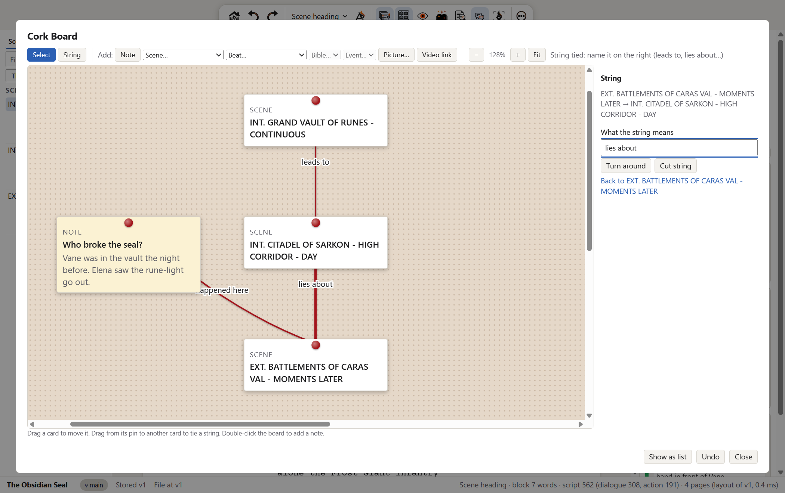
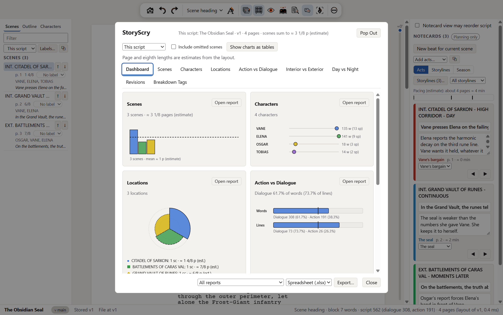
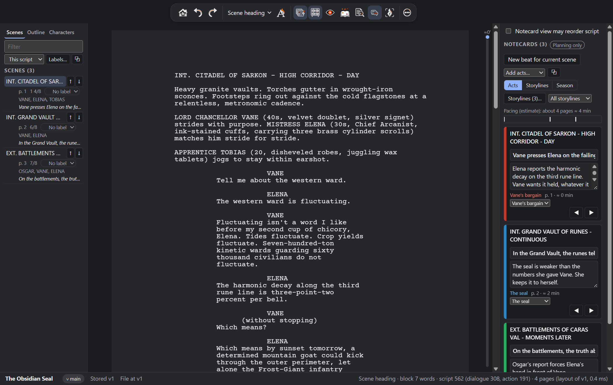
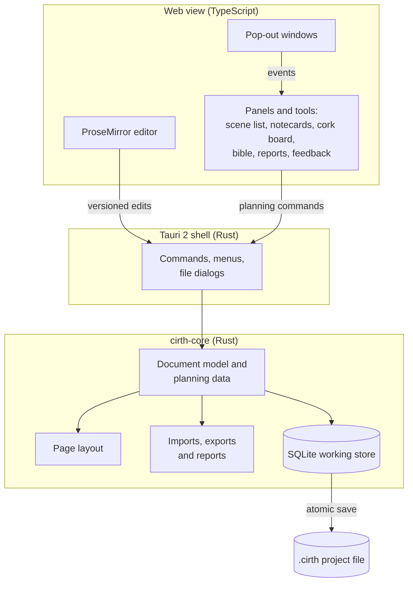

<p align="center">
  <picture>
    <source media="(prefers-color-scheme: dark)" srcset="app/public/art/brand/wordmark-dark.png">
    
  </picture>
</p>

<h3 align="center">Write the script, plan the story, prepare the shoot. One free app, on your own computer.</h3>

<p align="center">
  Kolbítar is a screenwriting app that keeps the whole story in one place: a screenplay editor that formats as you type, with the outline, notecards, cork board, story bible and production reports all built from the same script. It works offline, needs no account and costs nothing.
</p>

<p align="center">
  <a href="https://github.com/electrichobo/cirthscribe/releases"></a>
  
  <a href="LICENSE"></a>
  
</p>

<p align="center">
  
</p>

> **0.8.2 RC Alpha: a test release.** Kolbítar is being tested by working writers before its first full release. Expect rough edges, keep your own copies of anything important (File > Save As, or export to PDF or Fountain), and please [report what you find](#contributing).

## Contents

[Install](#install) · [About](#about) · [Features](#features) · [Getting started](#getting-started) · [How it's built](#how-its-built) · [Security and privacy](#security-and-privacy) · [Contributing](#contributing) · [What's next](#whats-next) · [License](#license) · [Acknowledgements](#acknowledgements)

## Install

1. Open the [latest release](https://github.com/electrichobo/cirthscribe/releases).
2. Download the file for your computer.
3. Run it.

| System | File | First launch |
| - | - | - |
| Windows 10 or later, 64-bit | `Kolbítar_0.8.2_x64-setup.exe` | The installer isn't code-signed yet, so SmartScreen may warn you. Choose **More info**, then **Run anyway**. |
| macOS 11 or later, Apple silicon | `Kolbítar_0.8.2_aarch64.dmg` | Drag Kolbítar to Applications. The app isn't notarized yet, so the first time, Control-click it and choose **Open**, or allow it in System Settings > Privacy & Security. |
| Linux | none yet | Linux builds are on hold while the Windows and macOS versions mature. You can [build from source](#build-from-source). |

If you use the [GitHub CLI](https://cli.github.com/), you can download the latest installer from a terminal:

```bash
gh release download --repo electrichobo/cirthscribe --pattern "*x64-setup.exe"
```

On a Mac, use `--pattern "*aarch64.dmg"` instead. There's no package-manager install (winget, Homebrew) yet.

Kolbítar never checks for updates by itself. **Help > Check for Updates…** opens the releases page, and each release lists what changed.

## About

Kolbítar (say *KOHL-bee-tar*) is Old Norse for "coal-biters". In the sagas, the kolbítr is the youngest son who sits by the hearth while everyone writes him off, until he gets up and comes back the hero. It was also the name of the Oxford reading club where J. R. R. Tolkien read the Icelandic sagas with C. S. Lewis and Nevill Coghill.

The app is for the whole path from first idea to shooting script, and it's built on a few rules:

- **One script, many views.** The scene list, notecards, timeline, cork board, bible and reports all read the same script, so they can't drift out of sync. Moving a card never rewrites your pages unless you allow it.
- **Your work stays on your computer.** There's no account, no cloud and no telemetry. The app makes no network requests.
- **Your work is protected.** Autosave, rolling backups, crash recovery, undo, and an untouched copy of any project before its file format is upgraded.
- **Free, with no catches.** No subscription, paywall or paid tier, and the source is open under the GPL.

<table>
  <tr>
    <td width="50%"></td>
    <td width="50%"></td>
  </tr>
  <tr>
    <td align="center">The Cork Board: pin scenes and notes anywhere and tie them together with string.</td>
    <td align="center">StoryScry: reports on scenes, characters, locations and balance, each one exportable.</td>
  </tr>
</table>

## Features

### Write

| Feature | What it does |
| - | - |
| Screenplay editor | Formats scene headings, action, characters, parentheticals, dialogue and transitions as you type, on industry-standard pages in Courier Prime. |
| Other formats | Stage plays, multi-camera TV, comics, interactive stories and treatments. |
| Autocomplete | Suggests character names, locations, times of day and transitions from your own script and bible. |
| Page view, typewriter and focus modes | See the printed page, keep the line you're typing centred, or hide everything but the script. |
| Free Writing | A plain page for getting words down before they become a script. |
| Writing sprints | A timed sprint with a word goal, and your pace at the end. |
| Runtime estimate | A strip beside the script showing roughly how long it runs and where you are in it. |
| Spelling and style | US and UK English spell check with a personal dictionary, and offline grammar and style checks. |
| Languages | Hebrew, Arabic, Devanagari, Chinese, Japanese and Korean show on screen. Hebrew, Arabic and Devanagari also print. |
| Themes | Day, Night, Midnight, OLED and High Contrast. |

<p align="center">
  
</p>

### Plan

| Feature | What it does |
| - | - |
| Scene list and outline | Every scene with its page, length, cast and beat; acts and sequences in an outline you can rearrange. |
| Notecard View | A card for each beat, under its act. Colour-code cards by storyline, see a grid of storylines across the acts, or lay out a whole season of episodes side by side. |
| Cork Board | A free canvas for scenes, notes, pictures and video links, tied together with labelled strings. |
| Timeline | The story's events in story order, which can differ from script order, on a line you can scrub. |
| Story bible | Characters, locations and world notes. It suggests entries from your script and shows where each one appears. |
| Thoughts | A notes pad with lists and simple formatting that travels with the project. |
| Go To | Ctrl/Cmd+K finds any scene, character or command. The Go To menu also jumps to a page or a bookmark. |

### Revise and review

| Feature | What it does |
| - | - |
| Revision sets | Mark changes in the standard colours (White, Blue, Pink and on). |
| Locked pages and scene numbers | After a lock, new material goes on A and B pages and A and B scenes, so earlier numbers never move. |
| Snapshots and branches | Save versions, try a different direction on a branch, compare, and merge back. |
| Alternate takes | Keep several versions of a line or speech and switch between them. |
| Feedback | Comments, suggestions and notes tied to a phrase. An icon in the margin opens them, and none ever change the script. |
| Review packages | Send your feedback to someone else, or bring theirs in, as a small file. |

### Prepare for production

| Feature | What it does |
| - | - |
| Breakdown tags | Tag props, wardrobe, cast and more, colour-coded by category. |
| Stripboard | Arrange scenes into shooting days, in horizontal, vertical or compact strips. |
| Character sides | Pages for one actor's scenes. |
| StoryScry reports | Scenes, characters, locations, interior and exterior, day and night, action and dialogue, revisions and tags. Every report exports on its own. |

### Exchange files

| Direction | Formats |
| - | - |
| Import | Fountain, Final Draft (FDX), PDF (a best guess, with a report of what was guessed) and plain text |
| Export | PDF, Final Draft (FDX), Fountain, Word (DOCX), RTF, HTML and plain text, plus reports as spreadsheets |

Every export tells you what the format can't carry, and every import reports what it changed or left out.

## Getting started

1. **Open the sample.** Home has a sample script, *The Obsidian Seal*. Open it to see every view filled in.
2. **Take the tour.** **Help > Software Tour** walks through the main parts in a couple of minutes.
3. **Start your own.** Type a title on Home and choose **Create project**, or **Import a script…** to bring in a Fountain, Final Draft, PDF or text file.
4. **Write.** Press **Enter** for the next element and **Tab** to switch element (action to character, character to parenthetical). The toolbar's element menu shows where you are.
5. **Plan beside it.** The scene list and Notecard View sit either side of the script. The **Tools** menu opens everything else, and most tools can open in a window of their own.
6. **Share it.** **File > Export…** makes a PDF or any other format. Projects save as a single `.cirth` file, and **File > Save As** keeps a copy anywhere you like.

Projects live in the app's library folder until you save them elsewhere. Backups are kept for every project, and you can restore one from its card's menu on Home.

## How it's built

| Layer | Technology | Purpose |
| - | - | - |
| Core | Rust (`crates/cirth-core`) | The document model, storage, page layout, scene numbering, revisions, reports, and every import and export. It has no UI code. |
| Storage | SQLite (bundled with rusqlite) | The working store and the `.cirth` project file, with versioned, append-only schema migrations. |
| Desktop shell | Tauri 2 | The native window, menus and file dialogs, and the bridge between the UI and the core. |
| Editor | TypeScript and ProseMirror | The editing surface. It sends versioned edits to the core and never keeps a second copy of the script. |
| PDF | printpdf, rustybuzz, unicode-bidi | Paged PDF export with shaped right-to-left and Indic text. |
| PDF import | pdf-extract (lopdf) | Reads where each character sits on a PDF page. |
| Other formats | quick-xml, zip | Final Draft XML and Word packages. |
| Spelling | spellbook with SCOWL dictionaries | Offline spell check. |
| Build | Vite, Cargo | Builds the UI and the app. |
| Tests | Rust tests, a contract test, an end-to-end suite | The end-to-end suite drives the real app through two drivers: Chrome DevTools and WebDriver. |



The main window is the authority. Pop-out windows draw from it and send every change back to it, and the core refuses any change made against an out-of-date version, so two views can't overwrite each other.

### Project structure

```text
cirthscribe/
├── crates/cirth-core/   Core library (Rust)
│   ├── src/             Model, store, layout, imports, exports, reports
│   └── tests/           Integration tests, frozen older-format projects
├── app/
│   ├── src/             The UI: editor, panels, dialogs (TypeScript)
│   ├── src-tauri/       Desktop shell: commands, menus, installers
│   ├── public/          Icons and brand art
│   └── tests/           Contract test and end-to-end suite
├── assets/              Fonts, dictionaries, art, third-party notices
├── fixtures/            Sample scripts and reference page layouts
├── docs/                Spec, architecture, decisions, plans, checks
└── scripts/             Developer environment and setup scripts
```

### Build from source

You need Rust (stable), Node.js 24, and the [Tauri 2 prerequisites](https://v2.tauri.app/start/prerequisites/) for your system.

```bash
git clone https://github.com/electrichobo/cirthscribe.git
cd cirthscribe
cargo test -p cirth-core
cd app && npm ci && npm run build && cd ..
cargo build -p cirthscribe --release
```

The app is `target/release/cirthscribe` (`cirthscribe.exe` on Windows). To build an installer, run `npx tauri build` in `app/`.

On Windows, `scripts/dev-env.ps1` puts a checkout-local toolchain on your PATH. On Linux and macOS, `scripts/setup-linux.sh` and `scripts/setup-mac.sh` install what the build needs. End-to-end tests run with `npm run e2e:cdp` (Windows) or `npm run e2e:webdriver` from `app/`.

## Security and privacy

What protects you and your work today:

- **Nothing leaves your computer.** The app contains no network code: no telemetry, no update check, no cloud sync. It opens your web browser only when you click a link, such as Check for Updates or a video link on the Cork Board.
- **The interface is locked down.** Its content security policy lets it load only the app's own files, never a script from elsewhere. The app has no shell, file-system or web-request plugins. File dialogs only return a path, and the core does the reading and writing.
- **Files from other people are treated as data.** Review packages are plain data with no file paths in them. Pictures are checked by their contents and must be PNG, JPEG, GIF or WebP; SVG is refused because it can carry script. Video links are stored as text and never fetched. A PDF that the reader can't handle is refused with a message instead of crashing the app.
- **Your work is hard to lose.** Saves are atomic (written in full, then swapped in), backups roll for every project, and an untouched copy is kept before any format upgrade.
- **Crashes stay local.** If the core hits an error, it writes a note to `logs/crash.log` in the app's data folder. Nothing is sent anywhere.

Two things to know in 0.8.2:

- The installers aren't code-signed yet. Check a download against the SHA-256 checksum on its release page: `certutil -hashfile <file> SHA256` on Windows, or `shasum -a 256 <file>` on a Mac.
- The AI assistant isn't connected to any provider yet. Don't enter an API key in its settings, because this version would save the key inside the project file.

If you find a security problem, please don't post the details in a public issue. Open an issue that asks for a private contact, and the maintainer will reply.

## Contributing

This alpha exists to find problems before a wider release, so every report helps.

- **Report bugs and rough edges** in [Issues](https://github.com/electrichobo/cirthscribe/issues). Say which system and Kolbítar version you're on (Help > Licences… shows it), what you did, what you expected and what happened. Add a screenshot if it helps. Please don't attach a script you want to keep private; describe the problem or make a small test project instead.
- **Try it with other apps.** Open Kolbítar's exports in Final Draft, Word, Google Docs, Fountain apps or PDF readers, and import their files, then tell us what came through.
- **Run a manual check.** [docs/testing/MANUAL_CHECKS.md](docs/testing/MANUAL_CHECKS.md) lists checks that need a person, many not yet run. Pick one for your system and post the result.
- **Suggest improvements.** Describe what you were trying to do; that helps more than a specific solution.
- **Send code.** Pull requests are welcome under the project's license (GPL-3.0-only). Read [docs/ARCHITECTURE.md](docs/ARCHITECTURE.md) first, keep changes small, add tests, and run the core tests and both end-to-end drivers. New dependencies need the maintainer's agreement and a compatible license.

## What's next

Kolbítar is in RC Alpha. Before a 1.0 release:

- Fixes for the [known issues](#known-issues) below.
- Testing with Final Draft and other screenwriting apps, and with PDFs from other apps.
- Code-signed and notarized installers.
- Screen reader and real input-method (IME) testing.
- Chinese, Japanese and Korean in PDFs.
- Linux builds, once the Windows and macOS versions are further along.
- A working connection for the optional AI assistant, off by default, with every change previewed before it's accepted.

[docs/ROADMAP.md](docs/ROADMAP.md) has the full milestone plan, and [STATUS.md](STATUS.md) lists what has and hasn't been tested on each system.

### Known limits

- Word, RTF and HTML exports print dual dialogue one speech after the other.
- PDF import is a best guess. A PDF doesn't record which lines are headings, cues or dialogue, so Kolbítar works it out from where each line sits and reports what it guessed. Scanned PDFs can't be read, and bold, italic and underlining don't come through.
- Exchange with Final Draft and other apps follows their published formats but hasn't yet been tested in those apps.
- macOS 11 and Intel Macs haven't been tried yet.

### Known issues

Found in 0.8.2 and fixed for the next update:

- On a Mac, the first launch after installing can show an empty Home screen. Quit Kolbítar and open it again.
- Adding a card in the Notecard View right after adding feedback or an alternate take can say "Card not saved". Click again.
- In PDFs, an Arabic phrase can have a little extra space on each side.

## License

Kolbítar is free software under the [GNU General Public License, version 3 only](LICENSE), with one additional attribution term under section 7(b) ([NOTICE](NOTICE)).

In plain terms (the license text is what counts):

- Use it for free, for anything, including professional work. Your scripts are yours; the license covers the app, not what you write with it.
- Change it and share it. Forks and modified versions are welcome.
- Anyone who distributes Kolbítar or a modified version must do so under the same license, with the full source code.
- Copies and modified versions must keep the credit "Based on Kolbítar by Jared Hoy" in the NOTICE file and on any About or credits screen.
- It comes with no warranty.

The GPL doesn't forbid charging for copies, but anyone who sells Kolbítar or a version of it must give buyers the full source under the GPL. Kolbítar itself will always be free.

Third-party components keep their own licenses, listed in [docs/m0/LICENSES.md](docs/m0/LICENSES.md) and shipped with the app in [assets/legal/THIRD-PARTY-NOTICES.txt](assets/legal/THIRD-PARTY-NOTICES.txt).

## Acknowledgements

Kolbítar is created by Jared Hoy ([electrichobo](https://github.com/electrichobo)), who also drew its art. It stands on these projects:

| Project | License | Used for |
| - | - | - |
| [Tauri](https://tauri.app/) | MIT or Apache-2.0 | The desktop shell |
| [ProseMirror](https://prosemirror.net/) | MIT | The editor |
| [SQLite](https://sqlite.org/) and [rusqlite](https://github.com/rusqlite/rusqlite) | Public domain, MIT | Storage |
| [printpdf](https://github.com/fschutt/printpdf) | MIT | PDF export |
| [rustybuzz](https://github.com/harfbuzz/rustybuzz) (a Rust port of [HarfBuzz](https://harfbuzz.github.io/)) and [unicode-bidi](https://github.com/servo/unicode-bidi) | MIT, MIT or Apache-2.0 | Shaping and ordering non-Latin text |
| [pdf-extract](https://github.com/jrmuizel/pdf-extract) and [lopdf](https://github.com/J-F-Liu/lopdf) | MIT | PDF import |
| [quick-xml](https://github.com/tafia/quick-xml) and [zip](https://github.com/zip-rs/zip2) | MIT | Final Draft and Word files |
| [spellbook](https://github.com/helix-editor/spellbook) | MPL-2.0 | Spell check |
| [SCOWL](http://wordlist.aspell.net/) by Kevin Atkinson | Permissive | English dictionaries |
| [Courier Prime](https://quoteunquoteapps.com/courierprime/) | SIL OFL 1.1 | The screenplay font |
| [Noto](https://fonts.google.com/noto) Sans, Serif, Hebrew, Arabic, Devanagari and SC | SIL OFL 1.1 | Interface text and non-Latin scripts |
| [Vite](https://vite.dev/) and [TypeScript](https://www.typescriptlang.org/) | MIT, Apache-2.0 | Building the UI |

The [Fountain](https://fountain.io/) plain-text screenplay format made import and export simple to get right. Much of the code was written with AI coding agents working under the rules in [AGENTS.md](AGENTS.md).
